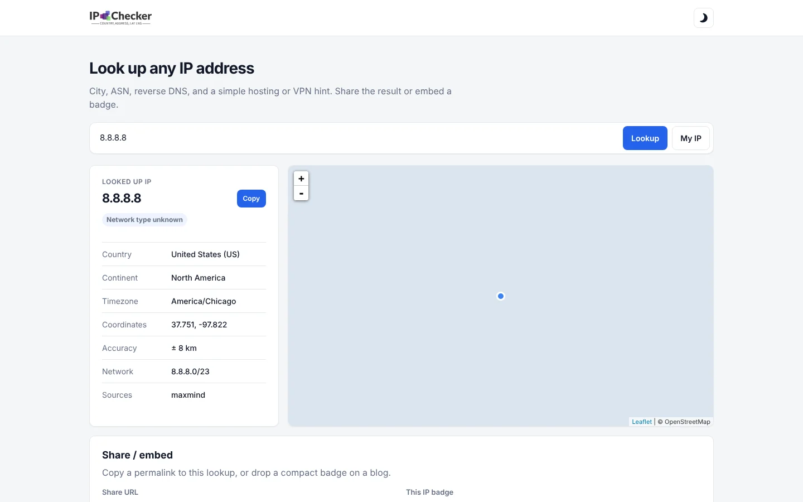

# IP Checker

An IP address lookup tool and free JSON API by [Mohd Amir Khan](https://khanamir.me). Enter an IP address or hostname to see its country, city, coordinates, timezone, ASN, network and reverse DNS, with a simple hint when it looks like a hosting provider or VPN.

Live: **https://tool.khanamir.me/ip-checker**



## Features

- Looks up IPv4, IPv6 and hostnames, or your own address with **My IP**
- Location, accuracy radius, timezone and network from the MaxMind GeoLite2 City and ASN databases, shown on a map
- Reverse DNS and a "likely hosting / VPN" hint based on the network owner
- Shareable result links and an embeddable badge (`badge.php?ip=…`)
- Light and dark mode

## JSON API

```bash
# Basic
curl "https://tool.khanamir.me/ip-checker/api/?ip=8.8.8.8"

# Detailed
curl "https://tool.khanamir.me/ip-checker/api/detailed/?ip=google.com"
```

Omit `ip` to look up the caller. CORS is open, and lookups are cached on the server for 24 hours.

## Tech

PHP 8, the MaxMind GeoIP2 PHP library, Tailwind CSS and Leaflet.

## Run locally

```bash
php -S localhost:8000
```

Open [http://localhost:8000](http://localhost:8000). To rebuild the CSS after changing classes, run `npm install` and then `npm run build-css`.

## Credits

This product includes GeoLite2 data created by MaxMind, available from [maxmind.com](https://www.maxmind.com).
